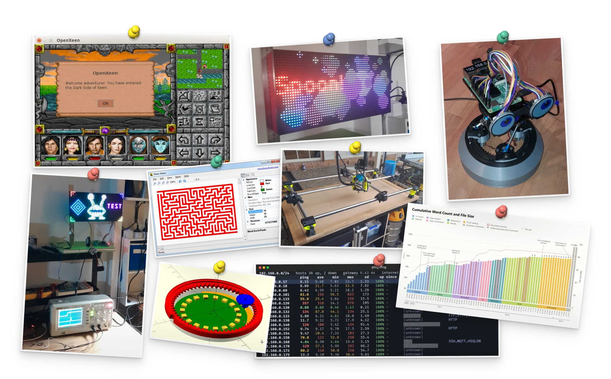

# busyDuckman

This is an eclectic space for some of my hobby projects.

## About Dr Warren Creemers (aka duckman)

I am a computer scientist; my PhD was in [affective computing](https://ro.ecu.edu.au/theses/680/).

In my spare time I make robots, write new engines for old video games, play with AI, build electronics projects, and try out data visualisation ideas.

I enjoy working in Rust, Python, C++, C#, CUDA, GLSL, OpenSCAD, and KiCad.

## Random photo album of stuff I'm working on

This profile holds hobby projects, made in my spare time.